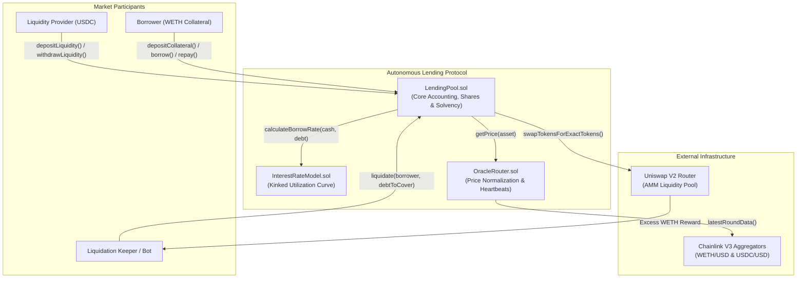
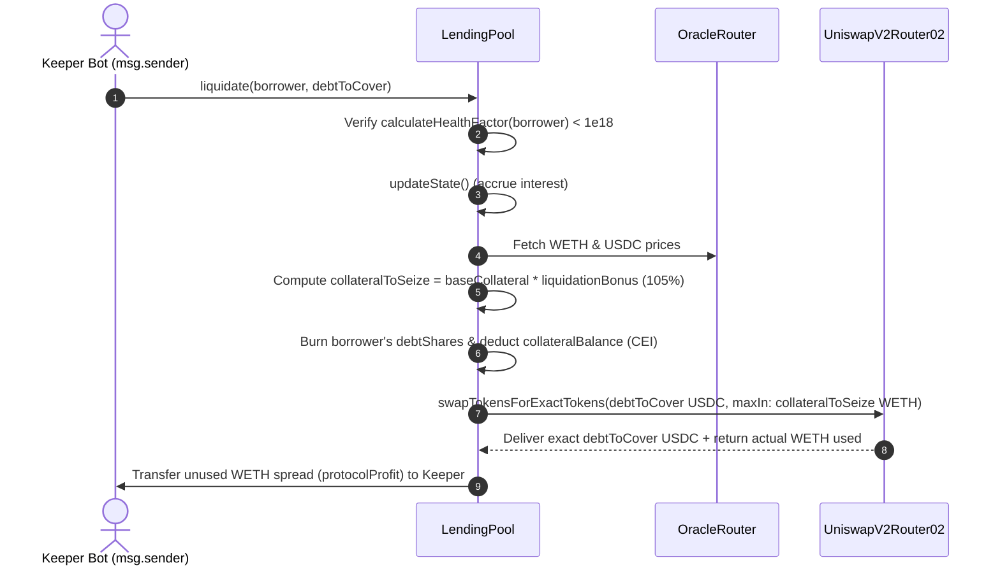

> **Note on `.env`**: I have intentionally included [`.env`](.env) file in version control with dummy/testnet configuration so reviewers and recruiters can inspect the required environment variables and run the deployment script out of the box. **In real-world production smart contract engineering, `.env` files and private keys are strictly git-ignored and never published.**

# Autonomous Lending Protocol


An isolated, overcollateralized DeFi lending protocol built in Solidity with **Foundry** and **Solady**.

Designed both as a **production-inspired smart contract implementation** and an **educational reference architecture**, this repository breaks down the core primitives of modern money markets (Aave V3 / Morpho Blue / Compound V3):
- **$O(1)$ Continuous Interest Accrual** via a global `borrowIndex` in `RAY` ($10^{27}$) precision.
- **Kinked (Two-Slope) Utilization Interest Rate Model** that dynamically balances capital efficiency and liquidity availability.
- **Zero-Capital Flash Liquidations** routed directly through an on-chain AMM (`UniswapV2Router02`), removing the need for liquidators to hold upfront repayment capital.
- **Multi-Decimal Chainlink Oracle Router** with per-asset staleness heartbeats and unified $10^{18}$ (`WAD`) price normalization.
- **Stateful Invariant & Property-Based Fuzz Testing** powered by Foundry handlers and ghost variables.

---

## Table of Contents

1. [System Architecture](#1-system-architecture)
2. [Core Protocol Mechanics & Math](#2-core-protocol-mechanics--math)
   - [Two-Slope Kinked Interest Rate Model](#21-two-slope-kinked-interest-rate-model)
   - [O(1) Lazy Interest Accrual & Share Accounting](#22-o1-lazy-interest-accrual--share-accounting)
   - [Multi-Decimal Health Factor Valuation](#23-multi-decimal-health-factor-valuation)
   - [Zero-Capital AMM Liquidations](#24-zero-capital-amm-liquidations)
3. [Smart Contract Security & Precision Engineering](#3-smart-contract-security--precision-engineering)
4. [Testing & Verification Suite](#4-testing--verification-suite)
5. [Getting Started & Developer Quickstart](#5-getting-started--developer-quickstart)
6. [Repository Structure](#6-repository-structure)
7. [Production Readiness & Future Roadmap](#7-production-readiness--future-roadmap)

---

## 1. System Architecture

The protocol isolates risk into a two-asset market where users supply a **Collateral Asset** (e.g., `WETH`, 18 decimals) to borrow a **Borrow Asset** (e.g., `USDC`, 6 decimals) provided by passive liquidity providers (LPs).



### Contract Breakdown

| Contract | Responsibility | Precision Unit |
| :--- | :--- | :--- |
| [`src/LendingPool.sol`](src/LendingPool.sol) | Manages collateral balances, LP & debt shares, lazy interest compounding, health factor checks, and AMM-backed liquidations. | `WAD` ($10^{18}$) & `RAY` ($10^{27}$) |
| [`src/InterestRateModel.sol`](src/InterestRateModel.sol) | Pure mathematical model computing annualized borrow rates from pool utilization across two linear regimes. | `RAY` ($10^{27}$) |
| [`src/OracleRouter.sol`](src/OracleRouter.sol) | Wraps Chainlink `AggregatorV3Interface` feeds, enforces round completeness and heartbeat staleness checks, and normalizes all prices to 18 decimals. | `WAD` ($10^{18}$) |

---

## 2. Core Protocol Mechanics & Math

> **Why two fixed-point standards?**
> Solidity has no native floating-point types. This protocol uses **Solady's `FixedPointMathLib`** (`mulDiv` and `mulDivUp`) across two industry-standard scales:
> - **`WAD` ($10^{18}$)**: Used for USD valuations, token normalization, liquidation thresholds, and Health Factors.
> - **`RAY` ($10^{27}$)**: Used for per-second interest rate accumulation and the global `borrowIndex` to prevent truncation when compounding over short time intervals ($\Delta t = 1\text{ second}$).

---

### 2.1. Two-Slope Kinked Interest Rate Model

Lending pools face a fundamental tension: low utilization means capital is sitting idle (low yield for LPs), while $100\%$ utilization means LPs cannot withdraw their funds (liquidity crunch).

To solve this, [`InterestRateModel.sol`](src/InterestRateModel.sol) implements a **piecewise linear curve** with an inflection point ("kink") at the optimal utilization ratio $U_{\text{optimal}}$:

$$U = \frac{\text{Total Debt}}{\text{Available Cash} + \text{Total Debt}}$$

```
Borrow APR
  ^
  |                                              /  <- Max Rate: R_base + R_slope1 + R_slope2 (81%)
  |                                            /
  |                                          /   Slope 2 (Penalty Regime: +75% APR)
  |                                        /     Discourages illiquidity & attracts fresh LPs
  |                                      /
  | - - - - - - - - - - - - - - - - - - *  <- Kink Rate: R_base + R_slope1 (6% APR)
  |                         /           |
  |             /   Slope 1 (+4% APR)   |
  | /                                   |
  *-------------------------------------+----------> Utilization (U)
  0%                                   80%      100%
                                  (U_optimal)
```

- **Regime 1 ($U \le U_{\text{optimal}}$)**: Gentle slope encouraging borrowing up to target efficiency.
  $$R_{\text{borrow}} = R_{\text{base}} + \left(\frac{U}{U_{\text{optimal}}}\right) \cdot R_{\text{slope1}}$$
- **Regime 2 ($U > U_{\text{optimal}}$)**: Steep penalty slope that rapidly increases borrowing costs, incentivizing borrowers to repay and LPs to supply fresh liquidity.
  $$R_{\text{borrow}} = R_{\text{base}} + R_{\text{slope1}} + \left(\frac{U - U_{\text{optimal}}}{1 - U_{\text{optimal}}}\right) \cdot R_{\text{slope2}}$$

---

### 2.2. $O(1)$ Lazy Interest Accrual & Share Accounting

Updating every borrower's balance on every block would cost $O(N)$ gas and quickly exceed block gas limits. Instead, [`LendingPool.sol`](src/LendingPool.sol) tracks a single global accumulator: **`borrowIndex`** (initialized at $1\text{ RAY} = 10^{27}$).

#### Step 1: Updating the Global Index (`updateState()`)
Before any state-changing action (`deposit`, `withdraw`, `borrow`, `repay`, `liquidate`), the protocol calculates the time elapsed since `lastUpdateTimestamp` ($\Delta t$) and compounds the index linearly over that interval:

$$\text{InterestFactor} = \frac{R_{\text{borrow}} \cdot \Delta t}{\text{SECONDS\_PER\_YEAR}}$$

$$\text{borrowIndex}_{t} = \text{borrowIndex}_{t-1} + \frac{\text{borrowIndex}_{t-1} \cdot \text{InterestFactor}}{10^{27}}$$

#### Step 2: Debt Shares vs. Actual Debt
When a user borrows an amount $B$, they are minted **debt shares** proportional to the current `borrowIndex`:

$$\text{debtShares} = \left\lceil \frac{B \cdot 10^{27}}{\text{borrowIndex}} \right\rceil$$

At any point in the future, a user's real-time debt (principal + accrued interest) is derived in $O(1)$ time without touching storage:

$$\text{ActualDebt}(\text{user}) = \frac{\text{debtShares}[\text{user}] \cdot \text{borrowIndex}}{10^{27}}$$

#### Step 3: Passive LP Yield Accrual
Liquidity providers receive `liquidityShares` when supplying `borrowAsset`. Because the pool's total expected assets equal its idle cash plus the compounded debt of all borrowers:

$$\text{TotalExpectedAssets} = \text{AvailableCash} + \frac{\text{totalDebtShares} \cdot \text{borrowIndex}}{10^{27}}$$

Every second that `borrowIndex` increases, the underlying value of each LP share grows automatically—requiring zero manual reward claiming or staking contracts.

---

### 2.3. Multi-Decimal Health Factor Valuation

DeFi tokens rarely share the same decimal precision (`WETH` uses $18$ decimals, `USDC` uses $6$ decimals, and Chainlink USD price feeds typically use $8$ decimals).

To avoid decimal mismatch bugs:
1. [`OracleRouter.sol`](src/OracleRouter.sol) scales all Chainlink prices to $18$ decimals (`WAD`).
2. [`LendingPool.calculateHealthFactor()`](src/LendingPool.sol#L96-L124) scales both collateral and debt token amounts by $10^{(18 - \text{decimals})}$ before multiplying by their $18$-decimal USD price.

$$\text{HealthFactor} = \frac{V_{\text{collateral, USD}} \cdot \text{LiquidationThreshold}}{V_{\text{debt, USD}}}$$

| Health Factor ($HF$) | Position Status | Protocol Action |
| :--- | :--- | :--- |
| $HF \ge 1.0 \times 10^{18}$ | **Solvent / Healthy** | Borrows and collateral withdrawals permitted. |
| $HF < 1.0 \times 10^{18}$ | **Undercollateralized** | Borrows/withdrawals blocked; position open to `liquidate()`. |

##### Concrete Numerical Walkthrough
1. **Setup**: ETH = $\$3,000$, USDC = $\$1.00$, Liquidation Threshold ($LT$) = $80\%$ ($0.8 \times 10^{18}$).
2. **Deposit & Borrow**: Alice deposits $2\text{ WETH}$ ($\$6,000$) and borrows $4,000\text{ USDC}$ ($\$4,000$).
   $$HF = \frac{\$6,000 \times 0.80}{\$4,000} = 1.20 \quad (\text{Healthy})$$
3. **Market Crash**: ETH drops to $\$1,500$. Alice's $2\text{ WETH}$ is now worth $\$3,000$.
   $$HF = \frac{\$3,000 \times 0.80}{\$4,000} = 0.60 < 1.0 \quad (\text{Liquidatable!})$$

---

### 2.4. Zero-Capital AMM Liquidations

In traditional lending protocols, a liquidator must hold (or flash-borrow) `USDC` to repay a borrower's debt before receiving discounted `WETH` collateral.

[`LendingPool.liquidate()`](src/LendingPool.sol#L251-L326) streamlines this by executing an **internal atomic swap against Uniswap V2**, allowing any keeper bot to trigger liquidations with **zero upfront capital** (paying only gas):



Because `swapTokensForExactTokens` sells *only* as much seized `WETH` as needed to buy the exact `debtToCover` in `USDC`:
- **Protocol Solvency Guard**: If AMM slippage is so high that `collateralToSeize` cannot cover `debtToCover`, the Uniswap router reverts the entire transaction.
- **Keeper Incentive**: Any leftover `WETH` from the $5\%$ liquidation bonus ($\text{collateralToSeize} - \text{collateralUsed}$) is transferred directly to `msg.sender` as pure profit.

---

## 3. Smart Contract Security & Precision Engineering

This codebase incorporates key defensive patterns expected in smart contract audits:

* **Asymmetric Rounding (Favoring the Pool)**:
  - In [`borrow()`](src/LendingPool.sol#L206), debt shares are minted using **`FixedPointMathLib.mulDivUp`** (rounding **up**). A borrower can never borrow "free dust" via integer truncation.
  - In [`repay()`](src/LendingPool.sol#L234), burned debt shares are calculated using **`FixedPointMathLib.mulDiv`** (rounding **down**), ensuring a partial repayment never clears more debt shares than the underlying tokens transferred.
  - When a user repays their full debt (`repayAmount == userActualDebt`), exact `userShares` are burned to prevent orphaned dust shares.
* **Checks-Effects-Interactions (CEI) Pattern**:
  - In [`liquidate()`](src/LendingPool.sol#L288-L296) and [`withdrawCollateral()`](src/LendingPool.sol#L143-L145), internal debt and collateral state mappings are decremented *before* external token transfers or Uniswap router calls occur.
* **Chainlink Oracle Validation**:
  - [`OracleRouter.getPrice()`](src/OracleRouter.sol#L28-L48) validates three critical invariants on Chainlink's `latestRoundData()`:
    1. `answer > 0` (guards against negative/zero circuit-breaker responses).
    2. `block.timestamp - updatedAt <= data.heartbeat` (per-asset staleness threshold).
    3. `answeredInRound >= roundId` (ensures round completion).
* **Overflow-Safe Intermediate Multiplication**:
  - Uses Solady's assembly-optimized `FixedPointMathLib.mulDiv(x, y, denominator)` to perform $512$-bit intermediate multiplication $(x \times y)$ before dividing, preventing phantom overflows on large `RAY` ($10^{27}$) calculations.

---

## 4. Testing & Verification Suite

The test suite is structured across three tiers of verification:

### 1. Unit & Scenario Tests ([`test/unit/`](test/unit/))
- **[`InterestRateModelTest.t.sol`](test/unit/InterestRateModelTest.t.sol)**: Verifies exact rate outputs at $0\%$ utilization, midpoint of Slope 1 ($40\%$), the exact optimal kink ($80\%$), midpoint of Slope 2 ($90\%$), $100\%$ utilization ceiling, and zero-liquidity edge cases.
- **[`LendingPool.t.sol`](test/unit/LendingPool.t.sol)**: Tests full multi-actor lifecycles including LP deposits, collateralization, 1-year `vm.warp` interest compounding, oracle price crashes, and profitable third-party AMM liquidations.

### 2. Stateless Property-Based Fuzzing
- **`testFuzz_RateMonotonicallyIncreases`**: Fuzzes arbitrary `uint128` combinations of `cash`, `borrowA`, and `borrowB` (where $\text{borrowA} \le \text{borrowB}$) to prove that the interest rate curve is strictly monotonically non-decreasing across its entire domain:
  $$\forall \text{borrow}_A \le \text{borrow}_B \implies R(\text{cash}, \text{borrow}_A) \le R(\text{cash}, \text{borrow}_B)$$

### 3. Stateful Handler-Based Invariant Testing ([`test/invariants/`](test/invariants/))
Rather than calling random functions that immediately revert, [`ProtocolHandler.sol`](test/invariants/ProtocolHandler.sol) wraps bounded user actions (`depositCollateral`, `withdrawCollateral`, `depositLiquidity`, `withdrawLiquidity`, `borrow`, `repay`, and `warpTime`) and tracks independent **ghost variables** (`ghost_totalWethDeposited`, `ghost_totalUsdcDeposited`).

Foundry executes randomized call sequences against the handler and asserts two system-wide invariants after every step in [`LendingInvariants.t.sol`](test/invariants/LendingInvariants.t.sol):
- **`invariant_CollateralIsSecure`**: The pool's actual `WETH` ERC-20 balance is always $\ge$ `ghost_totalWethDeposited`.
- **`invariant_ProtocolSolvency`**: After accruing pending interest via `pool.updateState()`, the pool's total accounting assets ($\text{USDC Cash} + \text{Compounded Debt}$) are always $\ge$ `totalLiquidityShares`.

---

## 5. Getting Started & Developer Quickstart

### Prerequisites
- [Foundry](https://book.getfoundry.sh/getting-started/installation) (`forge`, `cast`, `anvil`)

### Installation & Build

```bash
# Clone the repository (including forge-std and solady submodules)
git clone --recurse-submodules <repository-url>
cd autonomous-lending

# Compile contracts
forge build
```

### Running the Test Suite

```bash
# Run all unit, fuzz, and stateful invariant tests
forge test -vv

# Run only stateful invariant tests with detailed call traces
forge test --match-path test/invariants/LendingInvariants.t.sol -vvv

# Generate a gas report across all pool operations
forge test --gas-report
```

### Deploying the Protocol

1. Configure your RPC URL and deployer key in [`.env`](.env):
   ```bash
   source .env
   ```
2. Run the deployment script ([`script/DeployLendingPool.s.sol`](script/DeployLendingPool.s.sol)):
   ```bash
   # Dry-run simulation
   forge script script/DeployLendingPool.s.sol:DeployLendingPool

   # Broadcast & verify on Sepolia testnet
   forge script script/DeployLendingPool.s.sol:DeployLendingPool \
     --rpc-url $SEPOLIA_RPC_URL \
     --broadcast \
     --verify \
     --etherscan-api-key $ETHERSCAN_API_KEY
   ```

---

## 6. Repository Structure

```text
autonomous-lending/
├── src/
│   ├── LendingPool.sol             # Core lending market, share accounting & AMM liquidation engine
│   ├── InterestRateModel.sol       # Two-slope kinked utilization interest rate calculator (RAY)
│   └── OracleRouter.sol            # Chainlink V3 price feed aggregator with heartbeat checks
├── script/
│   └── DeployLendingPool.s.sol     # Automated deployment script for RateModel, OracleRouter & Pool
├── test/
│   ├── unit/
│   │   ├── LendingPool.t.sol       # End-to-end lifecycle & liquidation scenario tests
│   │   └── InterestRateModelTest.t.sol # Boundary, interpolation & stateless fuzz tests
│   ├── invariants/
│   │   ├── LendingInvariants.t.sol # System-wide solvency & collateral custody invariants
│   │   └── ProtocolHandler.sol     # Bounded stateful fuzzing actor with ghost variables
│   └── mocks/
│       ├── MockUniswapV2Router.sol # Simulated AMM router for liquidation testing
│       └── MockV3Aggregator.sol    # Simulated Chainlink price feed
└── foundry.toml                    # Foundry configuration & Solady remappings
```

---

## 7. Production Readiness & Future Roadmap

While this repository is feature-complete as a core protocol reference, deploying to an adversarial mainnet environment requires hardening several known edge cases:

1. **ERC-4626 First-Depositor Inflation Defense**: Mint virtual shares or burn dead shares on the initial `depositLiquidity()` call to prevent share-price manipulation via direct token donation.
2. **Non-Standard ERC-20 Handling**: Replace raw `IERC20.transfer` / `transferFrom` calls with Solady's `SafeTransferLib` to support tokens that do not return a boolean (e.g., mainnet `USDT`) and guard against tokens with $>18$ decimals.
3. **Close Factor & Bad Debt Socialization**: Enforce a maximum liquidation close factor (e.g., $50\%$ of debt per liquidation when above a critical threshold) and implement bad-debt socialization when an extreme market gap leaves `collateralBalance < collateralToSeize`.
4. **TWAP / Oracle-Bounded Liquidation Slippage**: Pass a minimum acceptable execution price or route through Uniswap V3 with TWAP validation to protect borrowers from sandwich attacks during AMM liquidations.

---

## License

Released under the [MIT License](https://opensource.org/licenses/MIT).
